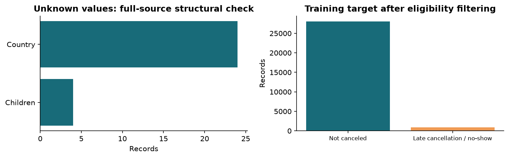
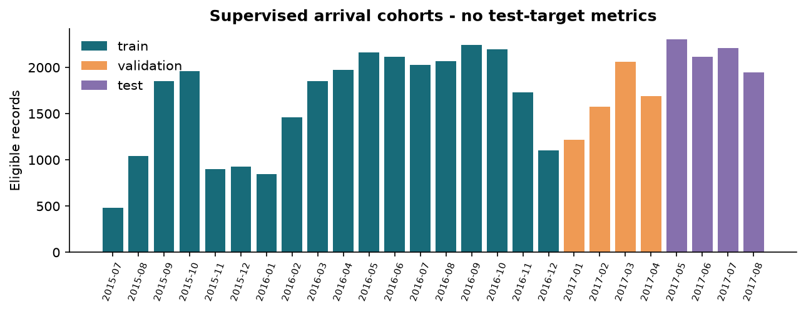
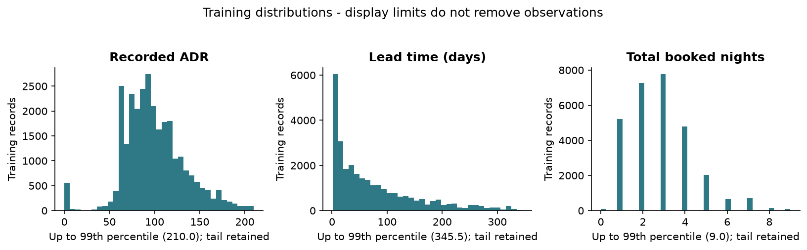
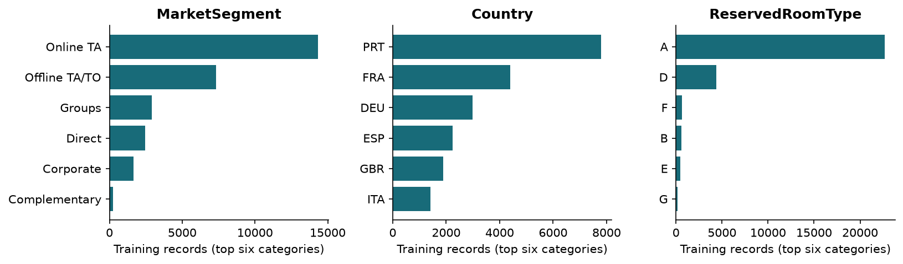
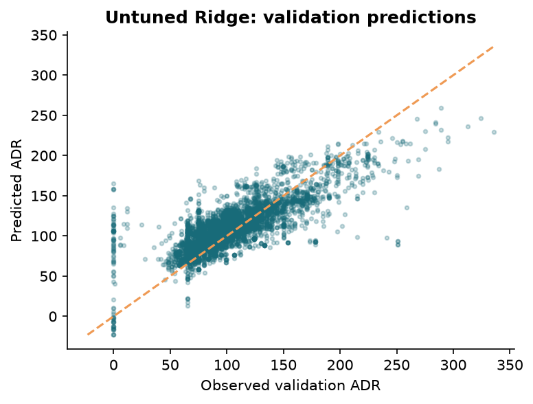
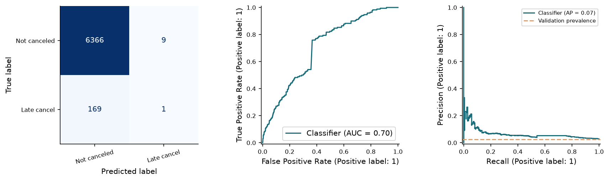
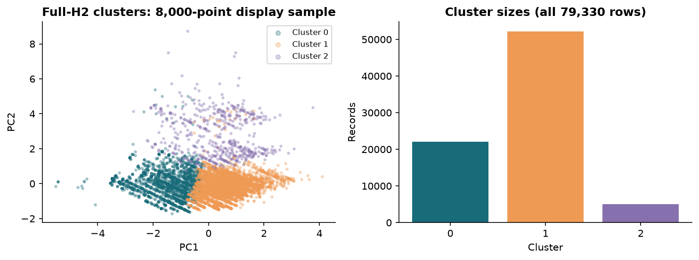

## Milestone 1

CITY HOTEL BOOKING DEMAND | CSE382 | 3 NOVEMBER 2026

**Data preparation and baseline experiments**

Technical progress report for H2 (City Hotel). This version contains executed experiments and reproducible source code. Responsibilities are assigned across the six confirmed members below. Individual completion evidence and other members' GitHub accounts remain pending before submission.

### Project team and assigned responsibilities

| Student name | Student ID | Assigned responsibility |
| --- | --- | --- |
| OMAR MEDHAT | 23P0026 | Dataset validation, EDA and GitHub coordination |
| AHMED MEDHAT | 230039 | Preprocessing, feature engineering and leakage audit |
| AHMED ADEL | 23P0046 | ADR regression and regression evaluation |
| MOHAMED HASSAN | 23P0042 | Cancellation classification and evaluation |
| AHMED MOKHTAR | 23P0081 | Clustering, profiles and PCA visualization |
| HALA ELTAWEEL | 23P0232 | Report, reproducibility and submission packaging |

| Area | Measured result / status |
| --- | --- |
| Source verified | 79,330 records; 31 original columns |
| ADR regression | Ridge validation MAE 17.92; RMSE 24.17; R-squared 0.541 |
| Cancellation ranking | Logistic validation ROC-AUC 0.704; average precision 0.0667 |
| Cancellation decisions | Default-threshold recall 0.59%; a material baseline weakness |
| Unsupervised baseline | K-Means, k=3; silhouette 0.220 (2,000-row sample) |
| Final supervised test | 8,576 held-out records; no test predictions or scores produced |

### What this milestone completes

Modular Python implementation, source verification, training EDA, reproducible temporal partitions, reusable preprocessing, one untuned model per required task, preliminary metrics, a dedicated leakage audit, and a plan for the remaining project.

### Scope that governs every result

Supervised predictions apply to bookings still active at the end of the day before scheduled arrival. They estimate recorded ADR and late cancellation/no-show risk. Results do not describe cancellation prediction when a booking is first created, or performance on the entire source population.

Repository: Omar-Medhat1 / CSE382-Hotel-Booking. Milestone 1 deadline in the supplied brief: 5 November 2026.

## 01 / Source and data quality

SOURCE-WIDE STRUCTURE; TRAINING-ONLY TARGET EXPLORATION

H2.csv was downloaded from the mirror specified in the course brief. Dimensions, all original source labels, field widths, the cancellation domain, status-label agreement, dates, nonnegative ADR, and a SHA-256 fingerprint were checked. H1 was not loaded or merged.

| Check | Observed value |
| --- | --- |
| Arrival coverage | 2015-07-01 through 2017-08-31 |
| Unknown Children / Country | 4 / 24 |
| Agent / Company not applicable | 8,131 / 75,641 |
| Duplicate rows after first occurrence | 25,902 |
| Zero nights / zero total guests | 331 / 167 |
| Zero adults / negative count entries | 390 / 0 |

Strip padded text. Convert genuine unknown markers in Children and Country to missing values. The paper explicitly defines NULL in Agent/Company as **not applicable**, so preserve it as a categorical level; do not median-impute these IDs [1]. Source names remain unchanged.



Retain duplicates: identical feature rows may represent real group bookings, and no unique booking ID is supplied. Keep same-date predictor groups within chronological cohorts and verify zero cross-partition overlap. Flag unusual values without inventing corrections or deleting valid rare bookings. Structural flags are not automatic removal rules.

The full fingerprint is recorded in config.json and results/run_summary.json. Source schema, category cardinalities, and training numeric ranges are exported as CSV tables.

## 02 / Prediction point and partitions

AN ACTIVE-BOOKING RISK SET WITH CHRONOLOGICAL HOLDOUTS

The source paper explains that many booking/change-log values were extracted relative to the day before arrival [1, sections 2-3]. A booking-creation forecast would therefore rely on unverified earlier values. The chosen snapshot is the **end of the day before scheduled arrival**.

Require LeadTime >= 1 and final ReservationStatusDate strictly after ArrivalDate minus one day. This excludes bookings created on arrival day, known earlier terminal outcomes, and same-snapshot-day outcomes whose event order cannot be determined. Terminal dates define eligibility only; they are never predictors.

| Partition | Arrival cohort / label availability | Records |
| --- | --- | --- |
| Training | Before 1 Jan 2017; labels before 31 Dec 2016 | 28,952 |
| Validation | 1 Jan-30 Apr 2017; labels before 30 Apr 2017 | 6,545 |
| Final test | 1 May-31 Aug 2017; evaluation reserved | 8,576 |
| Outside risk set | Already resolved, ambiguous day, or LeadTime=0 | 34,740 |
| Purged labels | Training / validation outcomes unavailable at cutoff | 247 / 270 |



The manifest assigns every source row a role. Predictor-group overlap across training, validation, and test is zero. Source-level integrity checks can inspect structure; supervised target patterns use training data only. No final-test predictions, loss values, class rates, or model comparisons are computed.

Limitations: activity is reconstructed from terminal dates, assuming no terminal-status reversal. Purging can remove longer-running outcomes near boundaries. This is an offline arrival-cohort evaluation, not a fully rolling production simulation. Missing booking/customer IDs prevent a complete independence audit.

## 03 / Features and preprocessing

EXPLICIT ALLOWLISTS; NO FITTED STATISTICS FROM VALIDATION OR TEST

| Block | Implementation and reason |
| --- | --- |
| Supervised numeric | LeadTime, arrival year/day, weekend/weekday nights, Adults, Children, Babies, IsRepeatedGuest, TotalNights, WeekendShare, and cyclic month sine/cosine. |
| Supervised categorical | Meal, Country, MarketSegment, DistributionChannel, ReservedRoomType, Agent, Company, CustomerType. IDs are categories rather than numeric magnitudes. |
| Missing values | Numeric median from training only; categorical UNKNOWN for true missingness. Agent/Company NOT_APPLICABLE remains its own category. |
| Encoding / scaling | One-hot encoding with unseen categories ignored; StandardScaler after numeric imputation. Fitted within a ColumnTransformer and Pipeline. |
| Feature engineering | TotalNights is booked weekday plus weekend nights; WeekendShare is weekend/total, defined as 0 for zero-night bookings. Month uses sin/cos. These operations are deterministic. |
| Clustering | log1p LeadTime and TotalNights; Adults, Children, Babies, WeekendShare; one-hot MarketSegment, CustomerType, ReservedRoomType. Separate fitted preprocessing on full H2. |

### Conservative exclusions

Never supply ADR or IsCanceled as inputs. Remove final status/date, eventual room assignment, changes accumulated through check-in/cancellation, deposits derived from later transactions, waiting-list duration, parking/request aggregates, and prior-booking outcome counts whose as-of timing cannot be checked. Omit redundant arrival week number.

This policy is task-specific and deliberately conservative. Some excluded fields could be legitimate with timestamp evidence. The complete 31-column decision table, including variable meanings and timing assumptions, is in docs/leakage-audit.md.

### Outliers and skew

Training distributions and IQR flags are exported. No percentile winsorization or target-driven row removal is fitted in this baseline. Strongly skewed lead time and stay length use log1p only in clustering, where raw distances would otherwise dominate. Standardized rare counts can still affect geometry and require sensitivity checks.

## 04 / Training exploration

DISTRIBUTIONS, CATEGORIES, AND UNUSUAL VALUES

Training has 28,952 eligible records. Its late-cancellation rate is 2.99%. ADR has mean 100.31, median 95.00, range 0-365, and skewness 0.687. There are 534 zero-rate training records; these may be complimentary or exceptional bookings and are retained.



Histograms display values through each training 99th percentile for legibility; every tail observation remains in model fitting and evaluation. Lead time and stay duration are right-skewed. IQR rules flag many rare binary/count values and should not be mistaken for evidence that those records are invalid.



The top categories show concentration in particular booking channels and room codes. One-hot encoding avoids imposing false numeric order. Sparse Agent/Company IDs and unseen categories can reduce generalization; model comparisons should test robustness to removing those identifiers.

Additional exported evidence: a training-only Pearson correlation heatmap, numeric percentiles/ranges, IQR bounds and skewness, every training category count, and the full-source schema/cardinality table. Correlations are descriptive rather than causal and do not establish feature timing.

## 05 / ADR regression baseline

VALIDATION RESULTS; NO HYPERPARAMETER SEARCH

Fit Ridge with alpha=1 and the lsqr solver. Standardize numeric features and one-hot encode categorical features inside the training-fitted pipeline. A training-mean DummyRegressor provides a reference. The recorded ADR is the target; no cancellation or final-status field is supplied.

| Model | MAE | MSE | RMSE | R-squared | Fit seconds |
| --- | --- | --- | --- | --- | --- |
| Training mean | 25.614 | 1274.196 | 35.696 | -0.000 | 0.066 |
| Ridge | 17.923 | 584.065 | 24.167 | 0.541 | 0.431 |



Relative to the mean reference, validation MAE falls by 30.0% and RMSE falls by 32.3%. R-squared 0.541 indicates useful but incomplete explanatory performance on this arrival cohort. Larger rate errors remain visible; one linear model is not sufficient for final selection.

These are validation metrics on 6,545 records, not final-test performance. ADR remains in source rate units; no unsupported currency conversion is imposed. Unconstrained Ridge can produce nonphysical negative rates for unfamiliar inputs, so it is a preliminary model rather than a production pricing tool.

Milestone 2 will compare additional model families before and after tuning, using temporally ordered training folds and a stated selection criterion. Fit times are measured on the current machine with two numerical threads and are not hardware-independent benchmarks.

## 06 / Cancellation baseline

RARE LATE CANCELLATIONS MAKE ACCURACY MISLEADING

Untuned logistic regression uses C=1, lbfgs, no class weighting, and a fixed 0.5 decision threshold. max_iter=2000 is a convergence allowance rather than a searched hyperparameter. The reference predictor uses the training class prior.

| Model | Accuracy | Precision | Recall | F1 | ROC-AUC | Avg. precision |
| --- | --- | --- | --- | --- | --- | --- |
| Prior | 0.9740 | 0.0000 | 0.0000 | 0.0000 | 0.5000 | 0.0260 |
| Logistic | 0.9728 | 0.1000 | 0.0059 | 0.0111 | 0.7043 | 0.0667 |



| Validation outcome | Not canceled prediction | Canceled prediction |
| --- | --- | --- |
| Actually not canceled | 6,366 true negatives | 9 false positives |
| Actually late canceled / no-show | 169 false negatives | 1 true positive |

Validation contains 170 positives among 6,545 records (2.60%). At 0.5, the model catches only 1/170 positives; it is **not operationally useful at this threshold**. Its accuracy is slightly lower than the always-negative reference, illustrating why accuracy alone is unsuitable.

ROC-AUC 0.704 and average precision 0.0667, compared with prevalence 0.0260, show some ranking signal. Average precision is the non-interpolated precision-recall summary from scikit-learn, not trapezoidal PR area. Ranking does not make the default decisions adequate.

Next: evaluate class weighting, nonlinear models, probability calibration, and thresholds using training-fold predictions. Select by a stated cost or precision/recall objective. Do not optimize a threshold against the final test set, or claim this risk-set result covers earlier cancellations.

## 07 / Unsupervised segmentation

FULL-H2 K-MEANS WITH NO OUTCOME FIELDS

Fit a separate K-Means pipeline on all 79,330 H2 bookings using the booking-profile allowlist. k=3 is a fixed exploratory starting point to inspect a small number of interpretable profiles; it is not the optimal selected k. Ten initializations and seed 382 reduce initialization dependence without a parameter search.

| Measure | Observed result |
| --- | --- |
| Input representation | 26 scaled numeric / one-hot dimensions |
| Silhouette | 0.2197; reproducible random sample of 2,000 records |
| Davies-Bouldin | 1.7386; all records |
| Inertia / fit seconds | 445,210.05 / 1.188 |
| 2-D PCA variance | 34.52% combined; visualization only |



| Cluster | Rows | Median lead | Median nights | Mean children |
| --- | --- | --- | --- | --- |
| 0 | 22,063 | 13 days | 2 | 0.00 |
| 1 | 52,179 | 109 days | 3 | 0.00 |
| 2 | 5,088 | 64 days | 3 | 1.42 |

Cluster 0 is a shorter-lead, shorter-stay profile; cluster 1 has longer booking lead times; cluster 2 concentrates bookings with children. These are descriptive booking groups, not verified customer identities or causal segments. Majority market/customer/room labels are similar across groups; numeric party/stay traits drive much of the separation.

Silhouette around 0.22 suggests overlapping rather than cleanly separated groups. The PCA projection retains only about a third of the representation variance and can hide structure. Rare-count scaling, weighting, alternative k, and stability need systematic investigation before selecting final segments.

## 08 / Leakage audit and verification

WHAT WAS CHECKED AND WHAT THE CSV CANNOT PROVE

| Risk | Control / evidence |
| --- | --- |
| Target / outcome leakage | Explicit allowlists exclude both targets, final status/date, and selected lifecycle aggregates. A full decision table covers all 31 original columns. |
| Snapshot mismatch | Use the paper's prior-day snapshot and an active-booking risk set. Earlier canceled bookings are excluded rather than relabeled as future outcomes. |
| Unavailable training labels | Purge labels dated at or after the first next-period snapshot day; remove 247 training and 270 validation rows. |
| Shared preprocessing | Supervised imputation, scaling, and encoding fit only on training rows. Serialized imputer statistics match training medians. |
| Duplicate contamination | Same-date identical predictor groups stay within cohorts; all three cross-partition overlap counts equal zero. |
| Future information in clustering | Full-source unsupervised transforms, PCA, and assignments are isolated; none becomes a supervised input or model-selection signal. |
| Test reuse | No supervised test scoring command is supplied in this milestone. The experiment summary explicitly records final_test_evaluated=false. |
| Serialization / reproducibility | Reloaded model predictions match validation reference outputs; the split manifest and source checksum reproduce. |

Automated tests also cover snapshot-day ambiguity, LeadTime=0, label-availability purging, outcome exclusion, validation-only unknown categories, train-statistic isolation, and zero-night feature behavior. Run main.py verify after baseline and python -m unittest discover -s tests -v.

Remaining limits: the CSV lacks timestamped field histories, booking IDs, and customer IDs; terminal reversals cannot be audited. Retained snapshot provenance remains an assumption. Cohort/seasonal shift and boundary censoring can affect performance. The rare-positive classification problem requires more suitable decision policies.

See docs/leakage-audit.md for the complete preliminary audit. A passing code check supports the recorded protocol; it does not certify every unobserved source timestamp or guarantee future generalization.

## 09 / Reproduction and remaining work

TEAM ROSTER CONFIRMED; GITHUB ACCOUNTS AND CONTRIBUTIONS PENDING

### Exact reproduction sequence

```powershell
py -3.12 -m venv .venv
.\.venv\Scripts\python.exe -m pip install -r requirements.txt
.\.venv\Scripts\python.exe main.py download
.\.venv\Scripts\python.exe main.py baseline
.\.venv\Scripts\python.exe main.py verify
.\.venv\Scripts\python.exe main.py report
.\.venv\Scripts\python.exe -m unittest discover -s tests -v
```

Verified Python 3.12.14; seed 382; two numerical threads. Pinned packages include scikit-learn 1.9.1, pandas 3.1.0, NumPy 2.5.4, and Matplotlib 3.11.2. Exact model parameters and measured fit times are in results/run_summary.json. Artifacts are generated locally; inference loads them without retraining.

### Milestone 2 plan

Compare at least three model/algorithm families per task, with baseline and tuned results for each. Add Random Forest and a kernel experiment; document search spaces and purged temporal folds. Prioritize rare-positive average precision and threshold tradeoffs. Compare K-Means, hierarchical clustering, and DBSCAN using unsupervised criteria and stability.

Complete supervised PCA comparisons for at least two models and an original/PCA/LDA classifier comparison. Freeze selection before final supervised test evaluation. Extend the CLI or add a GUI, expose comparison/tuning/clustering results, and retain saved inference artifacts for the discussion. Detailed plan: docs/milestone-2-plan.md.

### Team and contribution record

Assigned roles appear on the cover: Omar Medhat owns data/EDA and GitHub coordination; Ahmed Medhat preprocessing and leakage; Ahmed Adel regression; Mohamed Hassan classification; Ahmed Mokhtar clustering; Hala Eltaweel the report and reproducibility. Concrete tasks, files, commands, and completion criteria are in docs/contributions.md. These are assignments; completed contributions must be supported by actual work and evidence from each member's account. All members must understand the complete workflow.

The ZIP excludes raw downloaded data, fitted models/pipelines, virtual environments, and Git internals. Its README records the repository URL and submitted commit SHA. This remains a technical draft until other GitHub accounts and actual contribution records are completed.

### References

[1] Antonio, Almeida and Nunes (2019). Hotel booking demand datasets. Data in Brief 22, 41-49. https://pmc.ncbi.nlm.nih.gov/articles/PMC6297060/ . Source semantics: Table 1 and sections 2-3. [2] scikit-learn documentation: https://scikit-learn.org/stable/modules/compose.html and https://scikit-learn.org/stable/modules/clustering.html . Course requirements: supplied CSE382 project brief, Milestone 1 on page 10.
